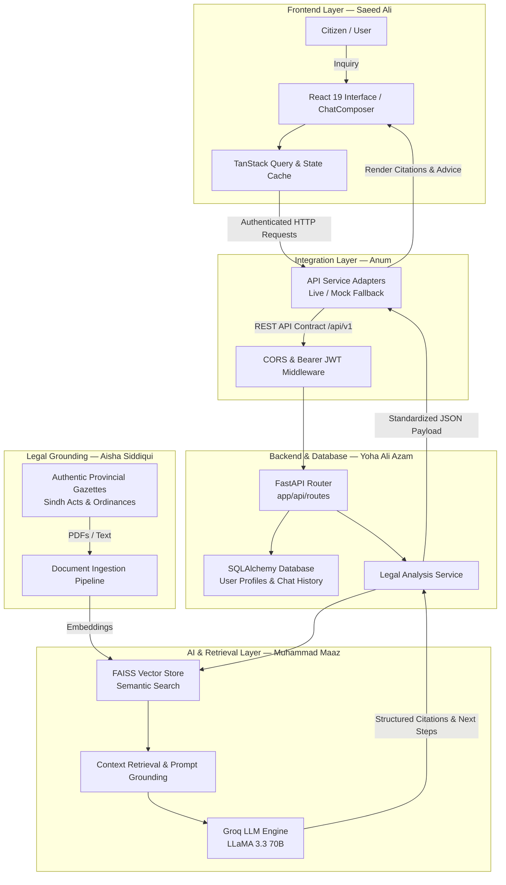

# ⚖️ Pakistan Legal Rights Agent (LegalSaathi AI)

[](LICENSE)
[](https://react.dev/)
[](https://www.typescriptlang.org/)
[](https://tailwindcss.com/)
[](https://www.python.org/)
[](https://fastapi.tiangolo.com/)
[](https://groq.com/)
[](https://github.com/facebookresearch/faiss)

An open-source, civic AI legal intelligence platform for Pakistan. Built to empower citizens, tenants, and workers with verifiable legal guidance, official provincial statutory citations, and procedural remedies across Sindh.

---

## 📑 Table of Contents

1. [Project Overview](#-project-overview)
2. [Team Members & Ownership Matrix](#-team-members--ownership-matrix)
3. [Architecture & Inter-Team Workflows](#-architecture--inter-team-workflows)
4. [Role-Specific Workflows](#-role-specific-workflows)
   - [1. Frontend Lead Workflow (Saeed Ali)](#1-frontend-lead-workflow--saeed-ali)
   - [2. Project Lead & Legal Research Workflow (Aisha Siddiqui)](#2-project-lead--legal-research-workflow--aisha-siddiqui)
   - [3. Backend & FastAPI Workflow (Yoha Ali Azam)](#3-backend--fastapi-workflow--yoha-ali-azam)
   - [4. Frontend-Backend Integration Workflow (Anum)](#4-frontend-backend-integration-workflow--anum)
   - [5. AI Agent & QA Lead Workflow (Muhammad Maaz)](#5-ai-agent--qa-lead-workflow--muhammad-maaz)
5. [Full-Stack Local Setup Guide](#-full-stack-local-setup-guide)
6. [Environment Variables Guide](#-environment-variables-guide)
7. [API Contract & Endpoints Summary](#-api-contract--endpoints-summary)
8. [Git Collaboration & Branching Strategy](#-git-collaboration--branching-strategy)
9. [Project Directory Layout](#-project-directory-layout)
10. [Troubleshooting & Common Team Pitfalls](#-troubleshooting--common-team-pitfalls)
11. [Frequently Asked Questions (FAQ)](#-frequently-asked-questions-faq)
12. [Team Contacts & Contribution Inquiries](#-team-contacts--contribution-inquiries)
13. [Legal Disclaimer & Civic Scope](#-legal-disclaimer--civic-scope)
14. [License](#-license)

---

## 🏛️ Project Overview

Over 240 million citizens in Pakistan encounter severe hurdles when attempting to understand their fundamental legal rights due to impenetrable statutory jargon, inaccessible gazette records, and high consultation costs. 

**Pakistan Legal Rights Agent** bridges this access gap through a civic legal intelligence platform grounded in authentic enactments:
- **Verifiable Statutory Grounding**: Direct references to authentic provincial enactments (*Sindh Rented Premises Ordinance, 1979*, *Sindh Industrial Relations Act, 2013*, *Sindh Shops and Establishments Act, 2015*, *Protection Against Harassment of Women at the Workplace Act, 2010*).
- **Exact Evidentiary Citations**: Every answer includes section numbers, gazette context, and confidence ratings.
- **Actionable Next Steps**: Step-by-step procedural guidelines (e.g., Section 33 grievance notices in Labour Courts, Section 11 applications before the Rent Controller).
- **Dual-Mode Development**: Supports both live FastAPI backends and a built-in offline mock adapter for rapid frontend development.

---

## 👥 Team Members & Ownership Matrix

Our team consists of 5 specialized engineers and researchers. Each member owns specific parts of the codebase:

| Team Member | Role | Primary Responsibility | Directory Ownership | Core Technologies |
|:---|:---|:---|:---|:---|
| **Saeed Ali** | **Lead Frontend Developer & System Architect** | UI/UX architecture, responsive citizen interface, state management, design system & animations | `frontend/src/` | React 19, TypeScript, Tailwind CSS v4, Framer Motion |
| **Aisha Siddiqui** | **Project Lead & Legal Tech Researcher** | Project initiation, statutory knowledge curation, provincial gazette verification, legal accuracy | `data/documents/`, `docs/` | Pakistani Jurisprudence, Legal RAG Taxonomy, Gazette Ingestion |
| **Yoha Ali Azam** | **Backend & FastAPI Engineer** | Microservices, API routing, database models, session management, and auth security | `app/api/`, `app/db/`, `app/services/` | Python 3.11, FastAPI, SQLAlchemy 2.x, SQLite, JWT |
| **Anum** | **Frontend & Backend Integration Engineer** | End-to-end API contract binding, authentication flows, CORS synchronization, integration testing | `frontend/src/services/`, `API_CONTRACT.md` | REST APIs, TanStack Query, Fetch Adapters, Contract Testing |
| **Muhammad Maaz** | **AI Agent Engineer & QA Testing Lead** | RAG retrieval pipelines, Groq LLM prompt grounding, vector search, test automation | `app/rag/`, `scripts/`, `tests/` | Groq API, FAISS, Sentence Transformers, Pytest, Ruff |

---

## 🔄 Architecture & Inter-Team Workflows

The following diagram illustrates how the team's components interact during a user query:



---

## 🛠️ Role-Specific Workflows

### 1. Frontend Lead Workflow — Saeed Ali
**Focus Area**: `frontend/`

- **Responsibilities**:
  - Maintain the React 19 + TypeScript component library, design system, and layouts.
  - Implement smooth page transitions and micro-animations with Framer Motion.
  - Optimize mobile responsiveness, accessibility, and SEO meta tags.
  - Ensure zero build/lint errors (`oxlint`, `tsc -b`).
- **Standard Commands**:
  ```bash
  cd frontend
  npm install              # Install dependencies
  npm run dev              # Launch Vite dev server on http://localhost:5173
  npm run lint             # Run Oxlint for static analysis
  npm run build            # Verify TypeScript types and generate production bundle
  ```
- **Key Configurations**:
  - Environment variables: `frontend/.env.local`
  - Style entry point: `frontend/src/index.css`
  - Routing layout: `frontend/src/app/router.tsx`

---

### 2. Project Lead & Legal Research Workflow — Aisha Siddiqui
**Focus Area**: `data/documents/`, `docs/`

- **Responsibilities**:
  - Source authenticated legal PDFs and statutory gazettes covering Sindh & Federal law.
  - Categorize statutory texts by topic before passing to document ingestion.
  - Review AI-generated legal summaries and citations to ensure strict adherence to Pakistani jurisprudence.
- **Document Naming Convention for Ingestion**:
  - Place raw legal files in `data/documents/` using standardized keyword naming:
    - **Unpaid Salary / Labour**: `sindh_shops_employment_act.pdf`, `payment_of_wages_act.txt`
    - **Workplace Harassment**: `workplace_harassment_act_2010.pdf`
    - **Tenant / Landlord**: `sindh_rented_premises_ordinance_1979.pdf`
- **Quality Standard**: Every document must be a primary official source (Gazette of Sindh or National Assembly).

---

### 3. Backend & FastAPI Workflow — Yoha Ali Azam
**Focus Area**: `app/api/`, `app/db/`, `app/services/`

- **Responsibilities**:
  - Build and maintain REST endpoints (`/health`, `/api/v1/auth`, `/api/v1/legal`).
  - Maintain SQLite schema and migrations via SQLAlchemy 2.x.
  - Implement robust JWT authentication, password hashing, and token validation.
  - Ensure cross-origin requests from the frontend are authorized via CORS settings.
- **Standard Commands**:
  ```bash
  # Windows PowerShell
  python -m venv venv
  .\venv\Scripts\Activate.ps1
  pip install -r requirements.txt

  # Run API server with hot reload
  python -m uvicorn app.main:app --reload --port 8000
  ```
- **Interactive Documentation**:
  - Swagger UI: `http://localhost:8000/docs`
  - ReDoc: `http://localhost:8000/redoc`

---

### 4. Frontend-Backend Integration Workflow — Anum
**Focus Area**: `frontend/src/services/`, `API_CONTRACT.md`

- **Responsibilities**:
  - Maintain the unified API contract ([API_CONTRACT.md](file:///d:/Pakistan-legal-Rights-agent/API_CONTRACT.md)).
  - Ensure typed frontend API clients in `frontend/src/services/` match backend Pydantic schemas.
  - Toggle and validate switching between Mock Mode and Live Backend Mode.
  - Test authentication header injection (`Authorization: Bearer <token>`) and error status handling (401, 422, 500).
- **Integration Testing Steps**:
  1. Start the FastAPI backend on port `8000`.
  2. In `frontend/.env.local`, set:
     ```env
     VITE_API_BASE_URL=http://localhost:8000/api/v1
     VITE_ENABLE_MOCK_API=false
     ```
  3. Start the frontend: `npm run dev`.
  4. Perform test sign-up, sign-in, and submit a legal query in the chat assistant to verify end-to-end payload flow.

---

### 5. AI Agent & QA Lead Workflow — Muhammad Maaz
**Focus Area**: `app/rag/`, `scripts/`, `tests/`

- **Responsibilities**:
  - Manage document chunking, embeddings (`sentence-transformers/paraphrase-multilingual-mpnet-base-v2`), and FAISS indexing.
  - Maintain Groq LLM integration (`llama-3.3-70b-versatile`) with prompt templates grounded in Pakistani statutory law.
  - Author and execute automated unit, integration, and health check test suites.
  - Enforce Python code quality with Ruff.
- **Standard Commands**:
  ```bash
  # Ingest documents from data/documents into the vector database
  python scripts/ingest_documents.py ingest --directory data/documents

  # Rebuild FAISS vector store
  python scripts/ingest_documents.py rebuild

  # Run automated test suites
  pytest

  # Run tests with code coverage
  pytest --cov=app --cov-report=html

  # Lint and format code
  ruff check app tests scripts
  ruff format app tests scripts
  ```

---

## 🚀 Full-Stack Local Setup Guide

Follow this guide to run both the FastAPI Backend and the React Frontend on your local machine:

### Terminal 1: Backend Setup (FastAPI)

```bash
# 1. Clone repository and navigate to root
git clone https://github.com/Aishasiddiqui97/Pakistan-legal-Rights-agent.git
cd Pakistan-legal-Rights-agent

# 2. Create and activate virtual environment
# Windows (PowerShell):
python -m venv venv
.\venv\Scripts\Activate.ps1

# Linux / macOS:
python3 -m venv venv
source venv/bin/activate

# 3. Install Python dependencies
pip install -r requirements.txt

# 4. Create environment file from template
cp .env.example .env
# Edit .env and supply your GROQ_API_KEY from https://console.groq.com

# 5. Ingest initial legal documents into FAISS vector store
python scripts/ingest_documents.py ingest --directory data/documents

# 6. Launch the backend API server
python -m uvicorn app.main:app --reload --port 8000
```
Backend will be live at `http://localhost:8000` (Swagger docs: `http://localhost:8000/docs`).

---

### Terminal 2: Frontend Setup (React 19 + Vite)

```bash
# 1. Open a new terminal and navigate to frontend directory
cd Pakistan-legal-Rights-agent/frontend

# 2. Install Node dependencies
npm install

# 3. Create frontend environment file
cp .env.example .env.local

# 4. Launch Vite development server
npm run dev
```
Frontend will be live at `http://localhost:5173`.

---

## 🔐 Environment Variables Guide

### Root Backend `.env`

| Variable | Description | Default / Example |
|:---|:---|:---|
| `APP_ENV` | Application environment | `development` |
| `APP_NAME` | Service title | `LegalSaathi AI` |
| `API_V1_PREFIX` | Prefix for version 1 API | `/api/v1` |
| `HOST` | Backend host binding | `0.0.0.0` |
| `PORT` | Backend port | `8000` |
| `GROQ_API_KEY` | Groq Cloud API key for LLM inference | `gsk_...` *(Required)* |
| `GROQ_MODEL` | Groq LLM model name | `llama-3.3-70b-versatile` |
| `DATABASE_URL` | SQLAlchemy database connection URI | `sqlite:///./legalsaathi.db` |
| `CORS_ORIGINS` | Permitted client origins | `http://localhost:5173,http://localhost:3000` |
| `EMBEDDING_MODEL` | HuggingFace embedding model ID | `sentence-transformers/paraphrase-multilingual-mpnet-base-v2` |
| `VECTOR_STORE_PATH` | Path where FAISS index files reside | `./data/vector_store` |
| `JWT_SECRET_KEY` | Secret key used for signing JWTs | `secure-secret-key-change-in-prod` |

### Frontend `frontend/.env.local`

| Variable | Description | Default |
|:---|:---|:---|
| `VITE_API_BASE_URL` | Base endpoint URL for the FastAPI backend | `http://localhost:8000/api/v1` |
| `VITE_APP_NAME` | Display name of the application | `Pakistan Legal Rights Agent` |
| `VITE_ENABLE_MOCK_API` | Use offline mock data adapter (`true`/`false`) | `false` (for live integration) |
| `VITE_API_TIMEOUT_MS` | Maximum request duration before timeout | `15000` |

---

## 📡 API Contract & Endpoints Summary

For complete schema definitions, see the [API Contract](file:///d:/Pakistan-legal-Rights-agent/API_CONTRACT.md).

### 1. Health Probes
- `GET /health/live`: Liveness check verifying process status.
- `GET /health/ready`: Readiness probe verifying database connectivity, vector index status, and Groq API readiness.

### 2. Authentication
- `POST /api/v1/auth/signup`: Create a new citizen account with email and password.
- `POST /api/v1/auth/login`: Authenticate credentials and receive Bearer JWT token.
- `GET /api/v1/auth/me`: Retrieve current user profile and session data (requires Bearer auth).

### 3. Legal Intelligence & RAG
- `POST /api/v1/legal/analyze`: Submit legal query with jurisdiction parameters (`city: Karachi`, `province: Sindh`, `category: unpaid_salary | workplace_harassment | tenant_landlord`).
- `POST /api/v1/legal/search`: Direct semantic search against indexed statutory chunks without LLM synthesis.

---

## 🌿 Git Collaboration & Branching Strategy

To keep collaboration smooth across all 5 team members without merge conflicts:

### 1. Branch Naming Standard
- Frontend enhancements: `feat/frontend-<feature-name>` (e.g. `feat/frontend-chat-stream`)
- Backend features: `feat/backend-<feature-name>` (e.g. `feat/backend-auth-refresh`)
- Legal RAG / QA updates: `feat/rag-<feature-name>` (e.g. `feat/rag-punjab-gazette`)
- Bug fixes: `fix/<issue-name>`
- Maintenance & audits: `chore/<description>`

### 2. Pre-Commit Checklist
Before opening a Pull Request or committing changes:

- **Frontend check**:
  ```bash
  cd frontend
  npm run lint       # Must have 0 errors
  npm run build      # Must build cleanly with 0 TypeScript errors
  ```
- **Backend check**:
  ```bash
  ruff check app tests scripts
  pytest
  ```

### 3. Merging Policy
- The `main` branch is the protected production-ready branch.
- Feature branches are reviewed and merged via Pull Request with passing CI tests.

---

## 📁 Project Directory Layout

```
Pakistan-legal-Rights-agent/
├── API_CONTRACT.md              # Official REST API contract specification
├── FINAL_STATUS_REPORT.md       # Comprehensive system status report
├── README.md                    # Project documentation & team workflows
├── pyproject.toml               # Python project configuration
├── pytest.ini                   # Pytest test suite configuration
├── requirements.txt             # Backend dependencies
├── .env.example                 # Backend environment variable template
├── .gitignore                   # Workspace Git ignore patterns
│
├── app/                         # FastAPI Backend Application (Yoha Ali Azam)
│   ├── main.py                  # Server bootstrap & CORS configuration
│   ├── api/
│   │   └── routes/              # Route handlers: health.py, auth.py, legal.py
│   ├── core/                    # Config, security, logging, error handlers
│   ├── db/                      # SQLAlchemy models, SQLite engine, sessions
│   ├── rag/                     # RAG pipeline: chunking, embeddings, FAISS store (Muhammad Maaz)
│   ├── schemas/                 # Pydantic request and response schemas
│   └── services/                # Business logic: auth_service, legal_service
│
├── data/                        # Legal Knowledge Base (Aisha Siddiqui)
│   ├── documents/               # Raw statutory enactments (PDF / TXT)
│   └── vector_store/            # FAISS index files and document metadata
│
├── scripts/                     # Automation Utilities (Muhammad Maaz)
│   └── ingest_documents.py      # CLI for chunking and vector index creation
│
├── tests/                       # Automated Test Suites (Muhammad Maaz)
│   ├── unit/                    # Unit tests for chunking, auth, routes
│   └── integration/             # End-to-end integration tests
│
├── docs/                        # Project Audits and Architecture Records
│   └── frontend-audit.md        # Complete frontend audit and cleanup log
│
└── frontend/                    # React 19 Frontend Application (Saeed Ali & Anum)
    ├── index.html               # Entry HTML with custom branded legal favicon
    ├── package.json             # Frontend dependencies & npm scripts
    ├── vite.config.ts           # Vite build configuration with Tailwind v4
    ├── tsconfig.json            # TypeScript configuration
    ├── .env.example             # Frontend environment template
    ├── public/
    │   └── favicon.svg          # Scales of Justice branded SVG favicon
    └── src/
        ├── main.tsx             # React DOM root mounting
        ├── app/
        │   ├── App.tsx          # Providers (QueryClient, AuthProvider, Router)
        │   └── router.tsx       # Code-split application route hierarchy
        ├── components/
        │   ├── ui/              # Reusable UI components (Buttons, Modals, Cards)
        │   └── layout/          # Navbar, Footer, Mobile Navigation
        ├── features/
        │   ├── auth/            # Sign In, Sign Up, and Auth Context hooks
        │   ├── legal-assistant/ # Real-time chat composer, message bubbles, suggested chips
        │   ├── profile/         # Citizen profile and jurisdiction settings
        │   └── evidence/        # Statutory citation cards and snippet modals
        ├── pages/               # LandingPage, AssistantPage, HistoryPage, WhoBuiltThisPage
        ├── services/            # API client and mock fallback adapter (Anum)
        └── types/               # TypeScript interfaces for API, Chat, and Citations
```

---

## 🔧 Troubleshooting & Common Team Pitfalls

### 1. Backend & AI Retrieval Issues (Yoha & Muhammad Maaz)

- **`GROQ_API_KEY is not configured`**:
  - *Cause*: `.env` file is missing or `GROQ_API_KEY` is empty.
  - *Fix*: Copy `.env.example` to `.env` and set `GROQ_API_KEY=gsk_...` from [console.groq.com](https://console.groq.com).
- **`Vector store is empty / 0 documents indexed`**:
  - *Cause*: FAISS index has not been generated from the source gazettes.
  - *Fix*: Run `python scripts/ingest_documents.py ingest --directory data/documents`.
- **`Failed to load embedding model` / Network Timeout**:
  - *Cause*: First execution downloads the HuggingFace sentence transformer (~500MB).
  - *Fix*: Ensure an active internet connection and write permissions in your Python environment.
- **`database is locked` (SQLite)**:
  - *Cause*: Multiple processes writing simultaneously to `legalsaathi.db`.
  - *Fix*: Terminate dangling Uvicorn processes or increase SQLite timeout in `app/db/session.py`.

### 2. Frontend Issues (Saeed Ali)

- **`Port 5173 is already in use`**:
  - *Fix*: Stop previous Vite instances or run `npm run dev -- --port 5174`.
- **`Missing styles / Tailwind CSS v4 errors`**:
  - *Fix*: Ensure `@import "tailwindcss";` is present in `frontend/src/index.css`. Do not create a separate `tailwind.config.js` as Tailwind v4 uses the `@tailwindcss/vite` plugin.
- **`Blank screen or unhandled mock data`**:
  - *Fix*: Check browser console. Ensure `VITE_ENABLE_MOCK_API=true` in `frontend/.env.local` if running without the FastAPI backend.

### 3. Integration & Networking Issues (Anum)

- **CORS error (`No 'Access-Control-Allow-Origin' header`)**:
  - *Fix*: Verify that `CORS_ORIGINS` in root `.env` includes the frontend port (e.g., `http://localhost:5173,http://localhost:3000`).
- **`401 Unauthorized` on `/api/v1/legal/analyze`**:
  - *Fix*: Check if your JWT token has expired or if you need to log in again via `/api/v1/auth/login`. In mock mode (`VITE_ENABLE_MOCK_API=true`), mock tokens do not expire.
- **Port mismatch (`ECONNREFUSED 127.0.0.1:8000`)**:
  - *Fix*: Ensure the backend Uvicorn command specifies `--port 8000` matching `VITE_API_BASE_URL=http://localhost:8000/api/v1`.

---

## ❓ Frequently Asked Questions (FAQ)

<details>
<summary><strong>Can I develop the frontend without having Python or Groq API configured?</strong></summary>

**Yes, absolutely.** The frontend includes an offline mock data adapter. Simply create `frontend/.env.local` with `VITE_ENABLE_MOCK_API=true`. You can test all citizen interfaces, interactive citations, responsive chat, and profile management without starting FastAPI.
</details>

<details>
<summary><strong>Where should new Pakistani law acts or provincial gazettes be placed?</strong></summary>

Place verified PDF or TXT statutory documents inside `data/documents/`. Use topic keywords in the filename (e.g., `sindh_rented_premises.pdf`, `workplace_harassment_act.txt`). Then execute `python scripts/ingest_documents.py ingest --directory data/documents` to re-index.
</details>

<details>
<summary><strong>How do I add a new route or page to the frontend?</strong></summary>

1. Create your component in `frontend/src/pages/YourPage.tsx`.
2. Register the route in `frontend/src/app/router.tsx` using React lazy loading.
3. If navigation links are needed, update `frontend/src/components/layout/Navbar.tsx`.
</details>

<details>
<summary><strong>How can I inspect the live API request/response format?</strong></summary>

Run the backend and visit Swagger UI at `http://localhost:8000/docs`, or read the standardized [API_CONTRACT.md](API_CONTRACT.md).
</details>

---

## 📬 Team Contacts & Contribution Inquiries

For questions regarding development, code reviews, or architectural decisions:

| Name | Role | Email / Profile | Specialization |
|:---|:---|:---|:---|
| **Saeed Ali** | Lead Frontend Developer & System Architect | `saeedaliofficial77@gmail.com` | React 19, UI/UX, Component Architecture, Design System |
| **Aisha Siddiqui** | Project Lead & Legal Tech Researcher | [GitHub @Aishasiddiqui97](https://github.com/Aishasiddiqui97) | Pakistani Jurisprudence, Gazette Verification, Project Vision |
| **Yoha Ali Azam** | Backend & FastAPI Engineer | Core Team Member | High-Concurrency APIs, SQLite, JWT Security, Microservices |
| **Anum** | Frontend & Backend Integration Engineer | Core Team Member | RESTful Contract Sync, State Pipelines, Cross-Stack Testing |
| **Muhammad Maaz** | AI Agent Engineer & QA Testing Lead | Core Team Member | Groq LLM Grounding, FAISS Vector Indexing, Test Suites |

- **Official Repository**: [https://github.com/Aishasiddiqui97/Pakistan-legal-Rights-agent](https://github.com/Aishasiddiqui97/Pakistan-legal-Rights-agent)
- **Bug Reports & Issues**: Open an issue on GitHub or email the respective domain lead.

---

## ⚖️ Legal Disclaimer & Civic Scope

> [!IMPORTANT]
> **Educational & Information Purpose Only**:
> Pakistan Legal Rights Agent is an artificial intelligence assistance tool designed to clarify civic rights and legal procedures under the laws of Sindh and Pakistan. **It does not constitute formal legal representation, legal advice, or an attorney-client relationship.**
>
> Laws and gazette interpretations evolve. For active court proceedings or formal litigation, citizens are strongly advised to consult an advocate enrolled with the **Sindh Bar Council** or the **High Court of Sindh**.

---

## 📄 License

This project is licensed under the [MIT License](LICENSE) — free and open for public civic empowerment.
